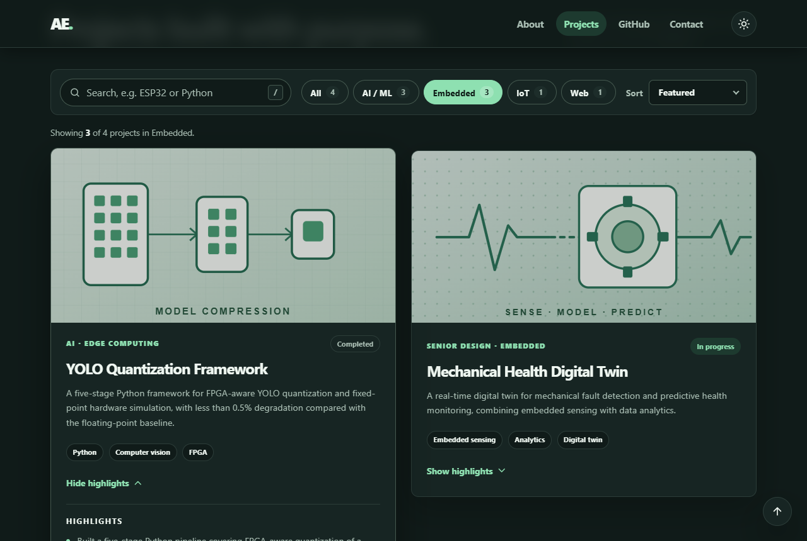

# Abdullah Ewidah — Interactive Portfolio

My personal portfolio website for **SWE 363, Assignment 2: Interactive Features**. It builds on my [Assignment 1 portfolio](https://github.com/abooodi123/202244620-abdullahewidah-assignment1). The static page is now an interactive site: you can search and filter projects, see live data from the GitHub API, use a contact form with validation and saved drafts, and see smooth, accessible motion throughout.

It is written in plain HTML, CSS, and JavaScript, with no frameworks, libraries, or build step.

**Live site:** https://abooodi123.github.io/202244620-abdullahewidah-assignment2/


---

## Contents

- [What's new since Assignment 1](#whats-new-since-assignment-1)
- [Features](#features)
- [Run it locally](#run-it-locally)
- [How to use the site](#how-to-use-the-site)
- [Project structure](#project-structure)
- [Testing and quality](#testing-and-quality)
- [Browser support](#browser-support)
- [AI use (summary)](#ai-use-summary)
- [Documentation](#documentation)

---

## What's new since Assignment 1

Assignment 2 started from an unchanged copy of Assignment 1. That was the first commit, so `git diff` shows every change. I treated Assignment 1 as a draft and fixed its weak spots before adding features.

| Area | Assignment 1 | Assignment 2 |
| --- | --- | --- |
| Projects | 3 static cards | 4 projects with live search, area filters, sorting, expandable highlights, an empty state, and shareable filter URLs |
| Data | Theme saved in `localStorage` | Live GitHub API data with a 30-minute cache, saved form drafts, and remembered preferences |
| Contact form | Browser validation bubbles | Inline, specific error messages, a character counter, draft autosave and restore, a success message, and a copy-email button |
| About | One paragraph | Accessible tabs: Overview, Skills, Education |
| Motion | None | Scroll reveals, hover feedback, a hero entrance, and a theme cross-fade, all switched off for reduced-motion users |
| Mobile navigation | Links squeezed into the header | Collapsible menu with Escape and outside-click support |
| Dark mode | The contact section turned light with low-contrast text | Dedicated color tokens with readable contrast in both themes |
| Theme loading | Page flashed the wrong theme before JavaScript ran | Saved theme applied before the first paint |
| Code | Project cards written as single-line HTML | Formatted markup; JavaScript split into small, isolated features |
| Testing | Manual checklist | 63 automated browser checks and Lighthouse audits |

---

## Features

Each assignment requirement is covered by at least one feature. Most are covered by several.

### Dynamic content (requirement 2)

- **Live project search.** Results filter while you type, so `esp32`, `python`, or `mqtt` narrow the list instantly. Search ignores case and accents and accepts several words.
- **Area filters.** All, AI / ML, Embedded, IoT, and Web. Each chip shows how many results it would give for the current search.
- **Sorting.** Featured, Name (A–Z), or In progress first.
- **Expand or collapse highlights** on every project card.
- **Shareable views.** Filters are saved in the URL, e.g. `?area=iot&q=mqtt`.
- **About tabs:** Overview, Skills, and Education, with full keyboard support.
- **Personal touches.** The site greets you by your time of day ("Good morning") and shows my current local time in Dhahran.

### Data handling (requirement 3)

- **Public API:** my public repositories are loaded from the [GitHub REST API](https://docs.github.com/en/rest/repos/repos#list-repositories-for-a-user). You can include or hide forks, sort them, and show all of them.
- **localStorage:** stores the theme, the include-forks preference, a 30-minute cache of GitHub results, and contact form drafts.
- **Form validation** with a clear confirmation message.

### Animation and transitions (requirement 4)

- Sections fade in as they scroll into view, and the hero copy rises in line by line.
- Cards lift on hover, filtered cards animate in, and highlights slide open.
- Success and error messages animate in. The error message also shakes briefly, and the success check mark draws itself.
- Switching the theme cross-fades the page in browsers that support the View Transitions API.
- **Everything respects `prefers-reduced-motion`.** Visitors who ask for less motion get a still page.

### Error handling and user feedback (requirement 5)

- **Loading:** skeleton cards and a "Loading repositories from GitHub…" message.
- **API errors:** a specific message for each problem (offline, timeout, rate limit, not found, or server error), each with **Try again** and a link to my GitHub profile. If GitHub fails but an older copy is cached, the site shows that copy and explains how old it is.
- **Empty states:** "No projects found" explains *why* nothing matched and offers a reset. The GitHub section explains when only forks exist and offers to show them.
- **Form errors:** each field says what is wrong and how to fix it, and the message clears as soon as you fix it.
- **Toasts:** short messages confirm actions such as "Email address copied" or "Draft discarded".

---

## Run it locally

You need a modern web browser. Nothing has to be installed.

### Option 1: open the file (quickest)

1. Download the repository: click **Code → Download ZIP** on GitHub and unzip it, or clone it:
   ```bash
   git clone https://github.com/abooodi123/202244620-abdullahewidah-assignment2.git
   cd 202244620-abdullahewidah-assignment2
   ```
2. Double-click `index.html` to open it in your browser.

### Option 2: use a local web server (closest to the live site)

Run **one** of these from the project folder, then visit the address it prints:

```bash
python -m http.server 8000        # then open http://localhost:8000
npx serve .                       # needs Node.js; then open the URL it prints
```

In VS Code, you can also right-click `index.html` and choose **Open with Live Server** (this needs the Live Server extension).

### Good to know

- The **GitHub section needs an internet connection.** Offline, it shows a friendly message and loads automatically once you reconnect.
- GitHub allows **60 requests per hour** for visitors without a GitHub login. The site caches results for 30 minutes, so normal browsing stays well under that limit.
- The **contact form opens your email app** with a ready-to-send draft. The site has no server, so nothing is sent until you press Send in your email app. If no email app is set up, use **Copy my message** or the **Copy** button next to my email address.

### Publish with GitHub Pages (optional)

In the repository, go to **Settings → Pages**. Under **Build and deployment**, choose **Deploy from a branch**, then select `main` and `/ (root)`, and save. After a minute or two the site will be at the live link above.

---

## How to use the site

| To… | Do this |
| --- | --- |
| Switch light or dark theme | Click the sun or moon button in the header. Your choice is remembered. |
| Search projects | Type in the project search box, or press **/** anywhere to jump to it. **Esc** clears it. |
| Filter projects | Click an area chip. The number on each chip shows how many projects match. |
| Read more about a project | Click **Show highlights** on a card. |
| Share a filtered view | Copy the address bar after filtering. It includes your search and filter. |
| Browse About tabs by keyboard | Tab to the tabs, then use **← →**, **Home**, and **End**. |
| See forked repositories | Turn on **Include forks** in the GitHub section. The setting is remembered. |
| Get the newest GitHub data | Click **Refresh** (results are otherwise reused for 30 minutes). |
| Send me a message | Fill in the form and click **Open email draft**. Unsent text is saved in your browser. |
| Return to the top | Use the ↑ button in the bottom-right corner. |



---

## Project structure

```text
202244620-abdullahewidah-assignment2/
├── index.html                  # Page structure and content (works without JavaScript)
├── css/
│   └── styles.css              # Design tokens, components, responsive rules, motion
├── js/
│   └── script.js               # All interactive features, one init function each
├── assets/
│   └── images/                 # Project illustrations and favicon (SVG)
├── docs/
│   ├── ai-usage-report.md      # How AI tools were used, checked, and corrected
│   ├── technical-documentation.md
│   └── screenshots/            # Images used in this README
├── tests/                      # Optional automated browser tests (Node.js)
├── .gitattributes              # Consistent line endings across operating systems
├── .gitignore
└── README.md
```

---

## Testing and quality

### Automated browser tests (optional)

The `tests/` folder drives the real page in headless Chrome or Edge and runs **63 checks** across six suites. They cover:

- the project explorer;
- the GitHub section, with simulated failures: rate limit, server error, network error, and empty data;
- contact form validation and drafts;
- tabs, keyboard support, and the no-JavaScript fallback;
- motion, the theme toggle, and the mobile menu;
- a keyboard-only pass through the whole page.

```bash
cd tests
npm install     # installs puppeteer-core, which uses your installed Chrome or Edge
npm test
```

If your browser is installed somewhere unusual, set `CHROME_PATH` to its executable first.

### Lighthouse (Chrome DevTools)

These scores were measured on a local server with Lighthouse 12:

| | Performance | Accessibility | Best practices | SEO |
| --- | --- | --- | --- | --- |
| Mobile | 100 | 100 | 100 | 100 |
| Desktop | 100 | 100 | 100 | 100 |

Mobile timings were: first contentful paint 1.1 s, largest contentful paint 1.6 s, total blocking time 0 ms, cumulative layout shift 0.

### Other checks

Scripted browser runs also checked the site at 320, 390, 768, 1024, 1280, and 1440 px wide in both themes, with no horizontal scrolling at any width. They also covered reduced motion, JavaScript turned off, and the browser in offline mode. Offline, the GitHub section shows its message and loads by itself when the connection returns. Every text color pair meets WCAG AA contrast (at least 4.5:1) in both themes.

---

## Browser support

The site was tested in **Google Chrome** and **Microsoft Edge** on Windows, at desktop and phone sizes. It uses standard, widely supported features (ES2020 JavaScript, CSS Grid and Flexbox, `IntersectionObserver`, `fetch`). Newer features are only used where the browser supports them, so older browsers still get a working page:

- The View Transitions API is used only if present.
- The Clipboard API falls back to an older copy method.
- Very old Safari versions get the older media-query listener.

Firefox and Safari should work, but I haven't tested them directly yet.

Without JavaScript, every project, highlight, and About panel stays visible, and the contact form uses the browser's own validation.

---

## AI use (summary)

I used **Claude Code**, Anthropic's AI coding assistant, running in VS Code, for this assignment. I used it to:

- audit Assignment 1;
- plan the features and branch structure;
- write and refactor the HTML, CSS, and JavaScript;
- write the automated browser tests and run Lighthouse;
- draft this documentation.

Every feature was checked in a real browser, and the AI's mistakes were caught and fixed. Examples include a collapsed panel that was still 33 px tall, a search that matched button labels, and accessibility problems carried over from Assignment 1. The full report lists the mistakes, explains how the key code works, and describes my own review: [docs/ai-usage-report.md](docs/ai-usage-report.md).

---

## Documentation

- [Technical documentation](docs/technical-documentation.md): architecture, data flow, storage, accessibility, performance, security, and known limitations.
- [AI usage report](docs/ai-usage-report.md): the tools used, how they were used, the mistakes found, and what I learned.

---

© 2026 Abdullah Mohammed Ewidah · Computer Engineering, KFUPM · [LinkedIn](https://www.linkedin.com/in/abdullah-ewidah-0a548b329/) · [GitHub](https://github.com/abooodi123)
