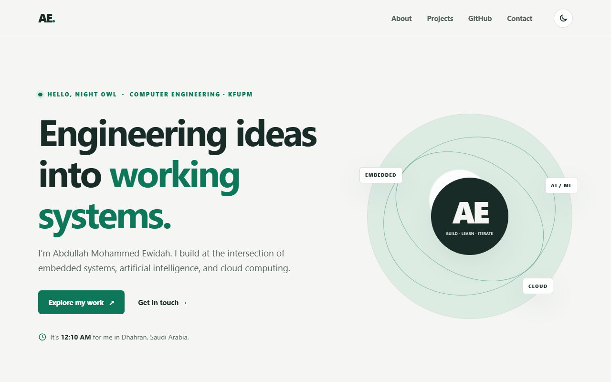
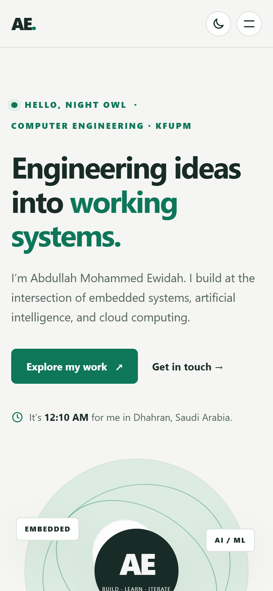

# Technical Documentation

This document explains how the portfolio is built: its structure, how each interactive feature works, where data is stored, and the choices made for accessibility, performance, compatibility, and security. For setup and usage, see the [README](../README.md).

## Contents

1. [Overview](#1-overview)
2. [Architecture](#2-architecture)
3. [Feature reference](#3-feature-reference)
4. [Data and storage](#4-data-and-storage)
5. [Styling system](#5-styling-system)
6. [Accessibility](#6-accessibility)
7. [Performance](#7-performance)
8. [Compatibility](#8-compatibility)
9. [Security and privacy](#9-security-and-privacy)
10. [Testing](#10-testing)
11. [Known limitations and next steps](#11-known-limitations-and-next-steps)

---

## 1. Overview

| | |
| --- | --- |
| Type | Static single-page website |
| Languages | HTML5, CSS3, JavaScript (ES2020, no modules) |
| Dependencies | None at runtime; `puppeteer-core` for optional tests only |
| External service | GitHub REST API (`GET /users/abooodi123/repos`), no API key needed |
| Hosting | Any static host; GitHub Pages recommended |
| Size | HTML 6.7 KB, CSS 9.2 KB, and JS 12.8 KB when compressed with gzip; 7 KB of SVG images |

---

## 2. Architecture

### 2.1 Progressive enhancement

The HTML is complete and readable on its own. JavaScript only *enhances* it:

| Without JavaScript | With JavaScript |
| --- | --- |
| All four projects and their highlights are listed | Search, filters, sorting, collapsible highlights |
| All three About panels are shown in order | Tabs with a sliding indicator |
| The contact form uses the browser's built-in validation | Custom inline validation, drafts, and success messages |
| A `<noscript>` message links to my GitHub profile | Live repository cards from the API |
| Navigation links stay in the header | A collapsible menu on phones |

Controls that only work with JavaScript, such as the project toolbar, tab buttons, details buttons, and copy button, are marked `hidden` in the HTML, and the script reveals them once it is ready. A small inline script in `<head>` adds a `js` class to `<html>`, and CSS uses `.js` to apply collapsed or hidden states only when they can be undone.

### 2.2 Files

| File | Responsibility |
| --- | --- |
| `index.html` | Content and semantic structure. The inline `<head>` script applies the saved theme before first paint. |
| `css/styles.css` | Design tokens, then components in page order. Each component keeps its own responsive rules next to it. Ends with motion, print, and reduced-motion rules. |
| `js/script.js` | Helpers at the top, one `init…` function per feature, and a start-up list at the bottom. |

### 2.3 JavaScript structure

`script.js` is a classic script loaded with `defer`. ES modules (`type="module"`) were considered but rejected, because browsers block module scripts on `file://` pages, and the README promises the site works by double-clicking `index.html`.

```text
Helpers           $, $$, storage, debounce, normalizeText, replayAnimation,
                  createElement, timeAgo, prefersReducedMotion, onMediaChange
Features          initTheme · initNavigation · initGreeting · initAboutTabs ·
                  initProjectExplorer · initGitHubRepos · initCopyEmail ·
                  initContactForm · initScrollEffects · initFooterYear
Start-up          [...features].forEach(init => try { init() } catch { console.error })
```

Each feature starts inside its own `try…catch`, so a failure in one (for example, an unexpected browser bug in the tabs) never stops the others from working.

---

## 3. Feature reference

### 3.1 Theme

- **No flash of the wrong theme:** the inline `<head>` script reads `localStorage` (or `prefers-color-scheme`) and sets `data-theme` before the CSS paints anything. Assignment 1 did this after load, which caused a visible flash.
- `initTheme` updates the button label ("Switch to light theme") and the `<meta name="theme-color">` used by mobile browser toolbars.
- If the visitor has never chosen a theme, live changes to the system theme are followed.
- Where `document.startViewTransition` exists, the switch cross-fades. Elsewhere it is instant.

### 3.2 Navigation

- On screens 680 px wide or less, the links collapse into a panel opened by a **Menu** button (`aria-expanded`, `aria-controls`). It closes on Escape (returning focus to the button), on an outside click, on a link click, or when the screen widens.
- An `IntersectionObserver` with `rootMargin: "-45% 0px -50% 0px"` watches a thin band across the middle of the screen. The section crossing that band gets `aria-current="true"` on its nav link, which also styles the highlight.

### 3.3 Greeting and local time

- `getGreeting(hour)` turns the visitor's local hour into "Good morning", "Good afternoon", "Good evening", or "Hello, night owl".
- `Intl.DateTimeFormat` with `timeZone: "Asia/Riyadh"` shows my time in Dhahran. The first update is timed to the next minute boundary, then repeats every 60 s, so the clock never runs up to a minute late.

### 3.4 About tabs

This follows the [WAI-ARIA Tabs pattern](https://www.w3.org/WAI/ARIA/apg/patterns/tabs/): `role="tablist"`, `tab`, and `tabpanel`, plus `aria-selected` and `aria-controls`.

- **Roving tabindex:** only the selected tab has `tabindex="0"`, so the Tab key enters and leaves the tab list in one step, and **← → Home End** move between tabs.
- The indicator is one absolutely positioned element moved with `transform: translateX(offsetLeft)` and `width`. Its transition is enabled one frame *after* the first placement, so it doesn't slide in from the left on load. Its position is recalculated (debounced) on resize.

### 3.5 Project explorer

Data comes straight from the HTML. Each `<article class="project-card">` carries:

```html
data-categories="iot embedded ai"  data-order="3"  data-status="completed"
data-keywords="gesture esp32 imu tinyml mqtt …"
```

On start-up, the script reads every card once into a `projects` array, along with a normalized `searchText`. That text is built only from the title, type, summary, tags, highlights, and keywords. Button labels are excluded, so typing "show" does not match every card.

**State → render.** One `state` object (`query`, `filter`, `sort`) drives a single `render()` function:

1. Sort a copy of the array with `PROJECT_SORTERS[state.sort]`.
2. Re-append each card in that order, so keyboard focus order always matches what is on screen.
3. Hide cards that fail the filter or the search. **Every** search word must appear (AND search).
4. Replay the entry animation only on cards that were hidden before, so existing cards don't flicker while you type.
5. Update the chip counts, the "Showing X of Y" summary (an `aria-live` region), the empty state, and the URL.

**Details used:**

- Typing is **debounced** by 120 ms, so the page re-renders once after a pause rather than on every keystroke.
- `normalizeText()` lowercases, removes accents (`NFD` + strip `̀–ͯ`), and collapses spaces.
- **URL sync:** `history.replaceState` writes `?q=…&area=…&sort=…`, leaving out default values. On load, those parameters are read back and validated against the known filters and sorts. Unknown values fall back to the defaults.
- **The empty state explains why nothing matched.** If the search matches projects in other areas, it says so and tells the visitor to choose "All".
- **Collapsible highlights** animate `grid-template-rows` from `0fr` to `1fr`, which works for content of any height without measuring it. `visibility: hidden` (switched after the collapse transition finishes) removes the collapsed content from the Tab order and from screen readers. All spacing lives *inside* the clipped wrapper, so a collapsed panel measures exactly 0 px.
- Pressing **/** focuses the search box unless the visitor is already typing in a field, and **Escape** clears it.

### 3.6 GitHub repositories (public API)

```text
page loads
        │
        ▼
fresh cache (< 30 min)? ──yes──► render it immediately: no network request,
        │ no                      and the cards are in the Tab order right away
        ▼
wait until the section is within 800 px of the screen (IntersectionObserver)
        │
        ▼
show skeleton cards + "Loading…" ──► fetch with 10 s timeout (AbortController)
        │                                   │
   success ▼                          failure ▼
save {savedAt, repos} to cache      older copy available? ──yes──► render it + explain how old it is
render cards                              │ no
                                          ▼
                              friendly error + Try again + profile link
```

**Error types and messages.** `fetchGitHubRepos()` throws errors tagged with a `kind`, and `describeGitHubError()` turns each kind into plain language:

| Kind | Detected by | The visitor is told |
| --- | --- | --- |
| `offline` | `navigator.onLine === false` | They are offline; the list loads automatically once they reconnect (the `online` event triggers a retry) |
| `timeout` | `AbortController` fires after 10 s | GitHub is slow; try again in a moment |
| `rate-limit` | HTTP 403/429 with `x-ratelimit-remaining: 0` | The hourly limit was reached, with the reset time from `x-ratelimit-reset` |
| `not-found` | HTTP 404 | The profile could not be found; use the profile link |
| `http` | Any other non-OK status, or a response that isn't JSON | An unexpected error, with its status code |
| `network` | `fetch` rejected (DNS, CORS, connection) | Check the connection, then try again |

- Only the eight fields the page uses are kept from each repository, which keeps the cache small.
- **Controls:** the *Include forks* switch (saved in `localStorage`), sorting by last push or by name, *Show all N repositories* (the first 6 are shown by default; expanding moves focus to the first newly shown card), and *Refresh* (skips the cache).
- An "Updated 5 minutes ago" label is refreshed every minute using `Intl.RelativeTimeFormat`.
- A visually hidden live region announces "Showing 2 of 2 repositories" to screen readers.

### 3.7 Contact form and clipboard

- `form.noValidate = true` is set **by JavaScript**, so the browser's built-in validation still works when the script doesn't run.
- `FIELD_RULES` maps each field to a function that returns an error message or `""`. Messages state the problem and the fix, for example *"This email address looks incomplete. Use the format name@example.com."*
- **When errors appear:** a field is validated only after the visitor leaves it with text in it, or after a submit attempt. After that it re-validates on every keystroke, so the error disappears the moment it is fixed. Invalid fields get `aria-invalid="true"` and are linked to their message with `aria-describedby`.
- **On submit with errors:** an animated "Almost there" alert appears and focus moves to the first invalid field.
- **On success:** the site builds a `mailto:` link with an encoded subject (the topic, if one was chosen) and body, shows an animated confirmation, and opens the email app. **The text stays in the form** in case no email app opens, and the alert offers *Copy my message* and *Clear the form*.
- The message is limited to 1,500 characters. Some email clients reject very long `mailto:` links, so the counter warns at 90%.
- **Drafts** are saved to `localStorage` 400 ms after typing stops and restored on the next visit with a "Welcome back" notice and a *Discard draft* button.
- `copyText()` uses `navigator.clipboard.writeText` on secure pages. Elsewhere, or if permission is denied, it falls back to a hidden `<textarea>` with `document.execCommand("copy")`, then returns focus to where it was. Results are confirmed with a toast (`role="status"`).

### 3.8 Scroll effects and motion

- A single passive `scroll` listener, throttled with `requestAnimationFrame`, toggles the header shadow and the back-to-top button.
- **Reveal:** an `IntersectionObserver` adds `.is-visible` once per block, then stops watching it. Blocks are faded with `opacity` and `transform` only, which the browser animates on the GPU without recalculating the layout.
- The hero entrance and the decorative orbit, label, and toast animations are written in CSS.
- **Reduced motion:** if the visitor asks for it, the script skips reveals and the theme cross-fade, and CSS shortens every animation and transition to 0.01 ms and stops the orbits.

---

## 4. Data and storage

The `storage` wrapper catches the errors `localStorage` throws in some private windows. If storage is blocked, features keep working; they just don't remember anything.

| Key (`STORAGE_KEYS`) | Value | Written when | Cleared when |
| --- | --- | --- | --- |
| `portfolio-theme` | `"light"` or `"dark"` | The theme button is clicked | Never (the visitor can toggle it) |
| `portfolio-github-forks` | `"true"` or `"false"` | The forks switch changes | Never |
| `portfolio-github-cache` | `{ savedAt, repos[] }` (about 2 KB) | After a successful API call | Replaced by the next successful call |
| `portfolio-contact-draft` | `{ name, email, topic, message }` | 400 ms after typing stops | Discard draft, Clear the form, or the form becomes empty |

All values are parsed defensively: corrupt JSON or values of the wrong type are ignored.

---

## 5. Styling system

- **Design tokens** on `:root` define every color, shadow, and radius. `:root[data-theme="dark"]` redefines them, so components never hard-code theme colors. The contact band stays dark in both themes, so it has its own `--contact-*` tokens. In Assignment 1 this band inverted in dark mode and its text lost contrast.
- **Layout** uses CSS Grid for page sections, cards, and repository lists, and Flexbox for toolbars, chips, and form rows.
- **Breakpoints:** 900 px (tablet) and 680 px (phone), plus a small 380 px adjustment. Each component keeps its own breakpoints next to it.
- **Hover effects** are inside `@media (hover: hover)`, so touch screens don't get "stuck" hover states.
- **Print styles** hide the interactive controls and show all content, including collapsed highlights.

| Desktop (1280 px) | Phone (390 px) |
| --- | --- |
|  |  |

---

## 6. Accessibility

- **Landmarks and structure:** a skip link, `header`, `nav`, `main`, and `footer`; one `h1`; and headings in order in each section.
- **Keyboard:** every control is a native `button`, `a`, `input`, or `select`. Focus rings appear on keyboard focus (`:focus-visible`). Shortcuts are **/** for search, **Esc** to close menus and clear search, and the arrow keys, **Home**, and **End** in the tabs. *Back to top* also moves focus to the main heading.
- **Screen readers:**
  - Live regions announce result counts, repository loading, form status, and toasts.
  - `aria-expanded` is set on the menu, highlights, and *Show all* buttons, and `aria-pressed` on the filter chips.
  - `aria-invalid` and `aria-describedby` link form fields to their errors.
  - Decorative SVGs have `aria-hidden="true"`.
- **Accessible names match visible text,** so voice-control users can say what they see. The brand link reads "AE. Abdullah Ewidah, back to top", using visually hidden text instead of an `aria-label`.
- **Contrast:** text colors meet WCAG AA in both themes.
- **Motion:** the site respects `prefers-reduced-motion` (see §3.8).
- **Result:** Lighthouse accessibility score of 100 on mobile and desktop.

---

## 7. Performance

| Measure | Why it helps |
| --- | --- |
| No frameworks, libraries, or web fonts | Nothing extra to download; system fonts render immediately |
| CSS in `<head>`, script with `defer` | The script never blocks the page from drawing |
| `width`/`height` on every image, plus `loading="lazy"` and `decoding="async"` | No layout shift (CLS 0); images below the screen load only when needed |
| Small vector images (SVG, 7 KB total) | Sharp at any size with almost no bytes |
| GitHub API called only when its section nears the screen | Visitors who never scroll there cost no network request |
| 30-minute API cache | Repeat visits render instantly and stay well under GitHub's 60 requests per hour |
| Debounced search and resize, rAF-throttled scroll | Little work per frame; total blocking time of 0 ms |
| Animating only `opacity` and `transform` | Smooth animations that don't make the browser redo the layout |

**Lighthouse 12 (local server):** Performance 100 on both mobile and desktop. Mobile timings were FCP 1.1 s, LCP 1.6 s, TBT 0 ms, and CLS 0.

Two items flagged by Lighthouse are deliberate:

- The code is not minified, so markers can read it.
- Compression and cache headers depend on the host. GitHub Pages compresses files automatically; Python's test server does not.

---

## 8. Compatibility

| Feature | Used for | Fallback |
| --- | --- | --- |
| `IntersectionObserver` | Reveals, active nav, lazy API call | Content is shown immediately and the API loads right away |
| View Transitions API | Theme cross-fade | Instant theme switch |
| `navigator.clipboard` | Copy buttons | Hidden `textarea` with `execCommand("copy")` |
| `MediaQueryList.addEventListener` | Theme and layout changes | `addListener` for Safari before version 14 |
| `history.replaceState` on `file://` | Shareable filter URLs | Wrapped in `try`; filtering still works |
| `backdrop-filter` | Frosted header | A semi-opaque background color |
| `grid-template-rows` transition | Highlight animation | The panel opens instantly |
| `-webkit-line-clamp` | Two-line repository descriptions | The description shows in full |

**Tested in:** Google Chrome and Microsoft Edge (Chromium) on Windows 11, at 320, 390, 768, 1024, 1280, and 1440 px wide, in both themes, with no horizontal scrolling at any width. Firefox and Safari have not been tested directly. The code avoids browser-specific APIs and includes the vendor prefixes they need (`-webkit-backdrop-filter`, `-webkit-appearance`).

---

## 9. Security and privacy

- **No HTML injection:** text from outside the code is never inserted with `innerHTML`. That includes what the visitor types and every field returned by the GitHub API. The `createElement` helper always uses `textContent`. The only `innerHTML` and `insertAdjacentHTML` calls insert fixed icon SVGs written in the code.
- **Link safety:** repository links are used only if they start with `https://github.com/`; otherwise they point to my profile. Every link that opens a new tab has `rel="noopener noreferrer"`.
- **No secrets:** the GitHub API is called without a login, so no token exists to leak.
- **Privacy:** the site has no analytics, cookies, or server. Form drafts stay in the visitor's own browser, and the message travels only through the visitor's email app.

---

## 10. Testing

### Automated (`tests/`, 63 checks)

Run `npm install`, then `npm test` inside `tests/`. The tests open the real `index.html` in headless Chrome or Edge through `puppeteer-core`.

| Suite | Covers |
| --- | --- |
| `projects.test.js` | `/` shortcut, live search, Escape, filters and counts, empty state and reset, sorting, highlights open and closed (0 px when collapsed), URL deep links |
| `github.test.js` | Live API load, forks switch and its saved setting, Show all and focus, cache reuse (no second request), simulated rate limit, HTTP 500 and network failure with retry, forks-only empty state, stale-cache fallback |
| `contact.test.js` | No errors while tabbing, empty submit, live error clearing, email format, counter, draft restore, success message, Clear, copy button |
| `about.test.js` | Greeting and clock, tabs by mouse and keyboard, roving tabindex, indicator position, **page with JavaScript disabled** |
| `keyboard.test.js` | Tabs through the whole page at 1280 px and 390 px; every stop must be on screen and show a focus ring |
| `motion.test.js` | Every reveal finishes, header shadow, back to top, theme saved across reloads, mobile menu (Escape and focus), no horizontal overflow, at 1280 px and 390 px |

### Manual checklist

1. Tab through the whole page with the keyboard only. Every control should be reachable and show a focus ring.
2. Resize from 320 px to 1440 px. There should be no horizontal scroll or clipped text.
3. Toggle the theme and reload. The choice should persist with no flash.
4. In DevTools, set **Network → Offline**, reload, and open the GitHub section. A friendly message should appear. Go back online and the list should load by itself.
5. Turn on **Emulate CSS prefers-reduced-motion** in DevTools. The page should be still.
6. Disable JavaScript. All content should still be readable.

---

## 11. Known limitations and next steps

- **No backend for the contact form.** It relies on the visitor's email app; *Copy my message* covers people without one. A future assignment could add a serverless form endpoint.
- **GitHub's rate limit** is per network. On a shared campus network the limit may be reached; the site then explains this and shows any cached copy.
- **Project data lives in the HTML.** With many more projects, moving it to a JSON file and rendering it with a template would scale better.
- **Firefox and Safari** should be tested directly before the final portfolio assignment.
